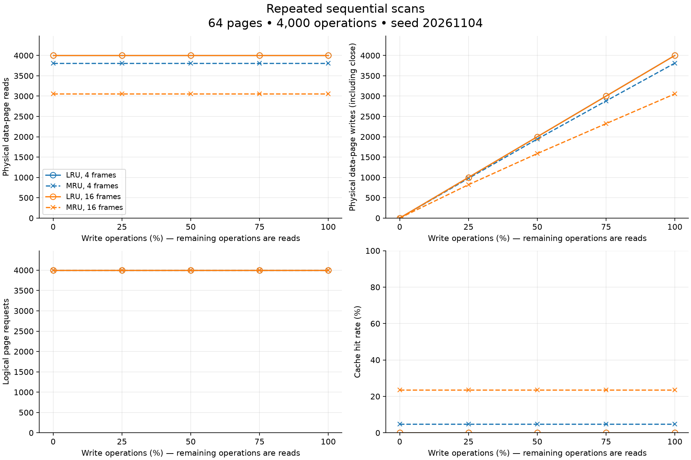
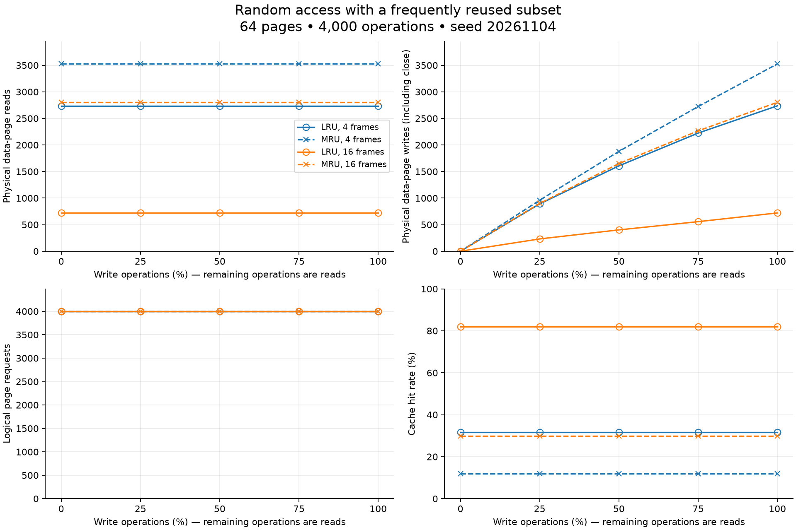
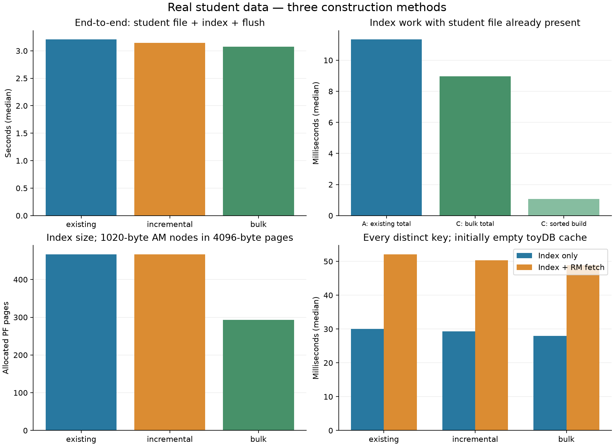

> Historical submission document. Supplied-data measurements describe the original
> private run; the public example uses synthetic data. See the root README and
> REDISTRIBUTION.md for current commands, provenance, and permission status.

# toyDB final assignment report

All three phases are implemented and validated on the supplied student data. The code retains the teaching implementation’s simple PF/RM/AM architecture. No transaction or concurrency framework was added.

## Task 1 — page buffering

A shared runtime-sized pool supports per-open-file LRU/MRU policies. The requesting file chooses among all unfixed frames; dirty victims are written using their own descriptor. Capacity defaults to 20 and locks when frame allocation starts. Explicit dirty marking, wide lookup/I/O counters and independent completed-operation counts are available. Headers are excluded from data-page counters.

The saved workload has 64 pages, 4,000 operations and seed 20261104. The table shows the 16-frame runs; page sequences and operation mixes are identical across paired policies.

| Pattern | Policy | Reads | Hit rate | Writes at 50% updates |
|---|---|---:|---:|---:|
| sequential | LRU | 4000 | 0.000% | 2000 |
| sequential | MRU | 3055 | 23.625% | 1586 |
| hot_random | LRU | 721 | 81.975% | 402 |
| hot_random | MRU | 2803 | 29.925% | 1650 |

MRU retains some pages across sequential cycles; LRU benefits from a frequently reused subset. Changing read/write labels alone leaves hit rates unchanged for these fixed page sequences. Several updates can coalesce into one write-back.

## Task 2 — variable-length records

Slotted pages use an 8-byte header and 6-byte offset/length/state slots. Packed records grow backward; eager deletion compaction preserves surviving (page,slot) RIDs. First-fit insertion, exact-copy retrieval and sequential scans use PF and promptly release pins. A separate fixed baseline reserves L payload bytes plus four metadata bytes per record.

The supplied export has a descriptive title, 17,813 records, 16 semicolon-separated fields, 1,759,011 useful bytes, and lengths 91..108. Title/line endings and the trailing blank line are excluded explicitly. Phase 2 used three LRU frames and one measured repetition.

| Format | L | Pages | Actual file B | Metadata B | Padding B | Unused B | Utilization | Insert ms | Scan ms |
|---|---:|---:|---:|---:|---:|---:|---:|---:|---:|
| slotted | 0 | 462 | 1894208 | 110574 | 0 | 22767 | 92.95% | 2714.183 | 3.783 |
| fixed | 108 | 495 | 2029508 | 75212 | 164793 | 28504 | 86.76% | 2458.410 | 3.267 |
| fixed | 162 | 743 | 3046308 | 77196 | 1126695 | 80426 | 57.80% | 3524.109 | 2.573 |
| fixed | 216 | 990 | 4059008 | 79172 | 2088597 | 128260 | 43.38% | 4805.040 | 2.661 |

Utilization is live payload divided by allocated 4096-byte data-page capacity. Payload + metadata + padding + unused equals that capacity in every row. PF overhead is separately eight file-header bytes plus four per data page. Slotted file-size savings are 6.67%, 37.82% and 53.33% against the three fixed formats. All records and scans were checked byte-for-byte after reopening. Short timings are observations, not stable speedup estimates.

## Task 3 — index construction

The accepted schema assumption is field 2 as the roll-number key: exact eight-byte character values, including zeros, letters and spaces. There are 17,810 distinct values and three duplicate pairs. No authoritative column schema was supplied. Every matching RID is retained and resolved through RM, using checked page*1024+slot encoding.

A: scan a populated record file and use ordinary AM insertion. B: insert each record and immediately insert its key/RID. C: extract and sort pairs, pack complete key groups into leaves, then construct balanced parent levels directly. C never substitutes repeated ordinary insertion for bulk loading.

All methods use 1020-byte AM nodes inside unchanged 4096-byte PF pages. Leaves hold sorted keys and linked RID lists; separators are minimum keys in right children. Root page 0 is maintained. The verified search-stack accumulation was repaired at search/scan ownership boundaries with bounds/error propagation. Scans use copied cursor state and release pages before returning.

Phase 3 used 20 LRU frames, seed 20261104 and three fresh repetitions. Times below are medians.

| Method | Complete student + index s | Index with existing student file ms | Sorted build + flush ms | Index pages | Index bytes | Height |
|---|---:|---:|---:|---:|---:|---:|
| existing | 3.208540 | 11.345 | — | 467 | 1914708 | 3 |
| incremental | 3.144835 | — | — | 467 | 1914708 | 3 |
| bulk | 3.073633 | 8.963 | 1.071 | 293 | 1201308 | 3 |

A/C index totals include extraction, optional sorting, construction and flush. B is measured as combined record-plus-index creation; no index-only B speedup is claimed. All end-to-end totals include student creation. Bulk construction from sorted pairs is reported separately from preparation.

| Method | Point index-only ms | Point plus record fetch ms | Range index-only ms | Range plus fetch ms |
|---|---:|---:|---:|---:|
| existing | 30.060 | 52.110 | 10.732 | 31.868 |
| incremental | 29.272 | 50.272 | 10.923 | 29.902 |
| bulk | 27.915 | 48.891 | 10.878 | 32.247 |

Each point batch queries all 17,810 distinct keys and returns 17,813 references. The default six range queries return 61,072 references in total; exact expected membership is checked. Fetch batches additionally verify full RM bytes. Query batches reopen after closing prior files and start with an empty toyDB cache; the OS cache is not cleared. A fresh query process follows every construction.

Bulk uses 174 fewer index pages (37.26%) than ordinary construction. All three methods have height 3 here. First-fit student-file creation dominates complete-import time, so the millisecond index savings have limited end-to-end effect. Query timing differences are modest and depend on packing, I/O and the active OS cache. No universal ranking is claimed.

## Validation and limitations

The complete PF/RM suites, supplied AM result sequences and new Phase 3 tests pass. Tests include repeated hits/misses interleaved with inserts/files, leaf/internal splits, all supported predicates, duplicates, overflow, pin cleanup, reopen, bulk structure and post-bulk ordinary insertion/splits. Focused AddressSanitizer/UndefinedBehaviorSanitizer runs pass. All real-data builds validate source bytes, tree structure, complete index scans, every distinct key and duplicate RID sets. See saved check/sanitizer/run logs and the raw CSVs.

Original AM test main functions have undefined legacy return status; outputs are independently checked. Existing compiler warnings remain. PF/RM and their earlier measured artifacts were preserved during Phase 3. AM headers were clarified without changing node size.

Limits: native ABI-dependent PF/AM layouts; single-page RM records; stale RIDs after slot reuse; snapshot index maintenance; first-fit search cost; process-lifetime global state; no crash/transaction/concurrency guarantees. Extreme duplicate groups or indivisible occupancy constraints fail explicitly. Sorting and validation references fit in memory. Split-construction failures should be discarded/rebuilt rather than treated as transactional rollback.

## Reproduction and submission

From the code directory: `make`, `make check`, `make sanitize`. Reproduce experiment tables with the three phase run.py commands in the top-level README. Source/config/data layout, dependencies, optional plotting commands and limitations are documented there.

The package includes source, tests, configurations, actual results/graphs, supplied data and original documentation. Its extracted copy is rebuilt and tested independently. Team roll numbers were not provided: rename submission-pending-team-rolls.tar.gz to the required rollno1-rollno2.tar.gz using verified values before submission. No upload, commit or push is performed.

## Ten viva questions

1. Why skip fixed frames? A caller still owns their buffer contents; replacement would invalidate that ownership.
2. How do LRU and MRU differ? They search eligible victims from opposite ends of the same recency list.
3. Why are logical requests different from physical reads? Cached lookups need no data-page read.
4. Why use slotted pages? Record bytes can move during compaction while their slot-based IDs remain stable.
5. Why keep roll numbers as characters? The actual values contain leading zeros, letters and spaces.
6. How does an index entry find a record? Decode its checked nonnegative integer into page/slot and call RM_GetRecord.
7. What caused the stack bug? Read-only searches accumulated paths intended for insertion split propagation.
8. How is bulk loading different? It sorts once and writes leaves/parents directly instead of searching/splitting per entry.
9. How are duplicates represented? One leaf key points to a linked list of all integer record references.
10. Why compare complete totals? Incremental construction includes record creation; comparing it with another method’s index-only time would be unfair.
